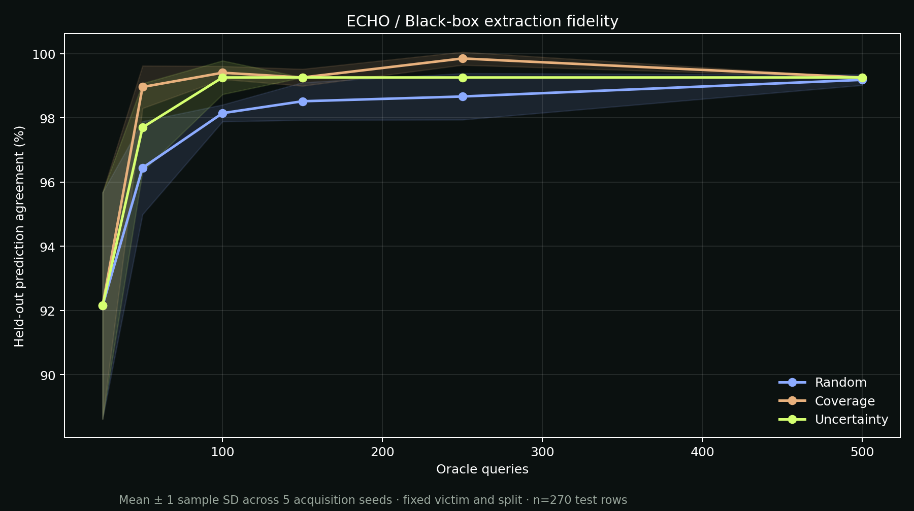

<div align="center">

# E C H O

### You can hide the model. Not the echo.

Query-efficient black-box model extraction, with an interactive research observatory.

[Open the observatory](https://shinde22-collab.github.io/Echo/) · [Measured results](results/metrics.csv) · [Experiment protocol](#experiment)

</div>



ECHO asks a simple question: **how much of a classifier’s decision behavior can another model reproduce using only prediction queries?**

A 160-tree Random Forest acts as the hidden model. A separate RBF support vector machine learns from its hard class outputs, without receiving original training labels, weights, architecture, or training examples. Three query strategies compete at six budgets across five acquisition seeds.

The observatory pairs those measured runs with a rotating 3D sample cloud, interactive fidelity curves, decision-boundary slices, an extraction replay, and live browser inference on held-out examples. No frontend framework or build step is required.

## Run locally

```bash
python -m venv .venv
```

Activate the environment with `.venv\Scripts\Activate.ps1` on Windows or `source .venv/bin/activate` on macOS/Linux, then:

```bash
python -m pip install -e .
python -m echo
python -m http.server 8765 --directory docs
```

Open http://localhost:8765. The dataset is bundled, so reproducing the benchmark needs no dataset download. Running the experiment rewrites the metrics, chart, and website data. Dependencies are pinned to the measured environment.

## Experiment

| Partition | Rows | Purpose |
| --- | ---: | --- |
| Victim training | 500 | Train the hidden Random Forest using original labels |
| Query pool | 578 | Supply unlabeled inputs to the extraction procedure |
| Held-out test | 270 | Evaluate fidelity and accuracy after training |

The raw UCI dataset contains 1,372 rows. Remove 24 duplicate feature vectors **before** partitioning to prevent identical inputs crossing the partition boundary. The remaining 1,348 rows are split with stratification and seed 42. Scaling is fitted exclusively on unlabeled pool inputs. No test examples or test labels enter acquisition or surrogate fitting.

| Setting | Value |
| --- | --- |
| Victim | RandomForestClassifier, 160 trees, random_state=42 |
| Surrogate | SVC, RBF kernel, C=10, gamma=scale |
| Oracle response | Hard class label only |
| Query budgets | 25, 50, 100, 150, 250, 500 |
| Acquisition seeds | 7, 19, 42, 73, 101 |
| Acquisition batch | Up to 25 rows |
| Primary metric | Agreement with victim predictions on the test set |

Each strategy starts with the same seeded 25-query initialization. **Random** continues through a random pool permutation. **Coverage** greedily selects the input farthest from the queried set in standardized feature space. **Uncertainty** selects inputs with the smallest absolute surrogate decision score and refits after each batch. Checkpoints are nested within a run; reaching the 500 checkpoint costs 500 extraction queries in total, rather than the sum of the checkpoint budgets. Every queried row counts, including repeated queries if a caller makes them. The provided strategies query each pool row at most once.

## Measured results

Mean fidelity across five acquisition seeds, expressed as percentages:

| Queries | Random | Coverage | Uncertainty |
| ---: | ---: | ---: | ---: |
| 25 | 92.15 | 92.15 | 92.15 |
| 50 | 96.44 | 98.96 | 97.70 |
| 100 | 98.15 | 99.41 | 99.26 |
| 150 | 98.52 | 99.26 | 99.26 |
| 250 | 98.67 | 99.85 | 99.26 |
| 500 | 99.19 | 99.26 | 99.26 |

The victim’s accuracy against true test labels is **98.52%**. Fidelity measures imitation, while accuracy measures task correctness; a surrogate can match a victim mistake. Higher query budgets do not guarantee monotonic fidelity. No strategy dominates every budget or seed.

The plotted band is ±1 sample standard deviation over acquisition seeds. The split and victim are fixed, so the band does not represent uncertainty across datasets, splits, or victim models. These are small-dataset proof-of-concept results, not a claim about extracting arbitrary production models.

The benchmark makes **7,500 extraction queries** across 15 runs. Trusted evaluation additionally computes victim predictions on 270 held-out samples and 4,800 visualization-grid points, outside the extraction budget. Those outputs are never available to the acquisition code.

## Prediction-only API

```bash
echo-oracle --port 8766 --budget 500
```

```bash
curl -X POST http://127.0.0.1:8766/predict \
  -H "Content-Type: application/json" \
  -d '{"features":[[3.6216,8.6661,-2.8073,-0.44699]]}'
```

Responses contain `predictions`, `used`, `limit`, and `remaining`. `GET /status` returns the query ledger. Invalid matrices return 400; exceeding the shared row budget returns 429 before consuming queries. Restart the process to create a new ledger. The server binds to localhost. It exposes neither model serialization nor a training endpoint.

The default benchmark passes a budgeted prediction callable to the extractor. `extraction.py` takes only pool features, the callable, a strategy, a seed, and budgets. The API is an optional process boundary for demonstrating prediction-only access. This is an experimental access boundary, not a hardened production security sandbox.

## Observatory

- Choose among three acquisition strategies and five seeds.
- Move between all six query checkpoints using the slider, budget labels, or curve points.
- Switch between victim, surrogate, and disagreement maps.
- Drag the 3D cloud or rotate it with arrow keys; pause motion with the top-right control.
- Replay saved checkpoints with narration of queries and held-out fidelity.
- Browse test samples and jump directly to disagreements.
- Download raw metrics or the complete experiment export.

The hosted page **replays recorded experiments**; it does not pretend to retrain Python models in the browser. Surrogate predictions in the sample inspector are evaluated live from exported support vectors. Victim responses are recorded. Only surrogate parameters are exported; the original Random Forest weights remain in the Python process. The 2D landscape fixes kurtosis and entropy at pool medians, while plotted query points are projections of four-dimensional inputs. The 3D cloud shows variance, skewness, and kurtosis of the held-out samples.

## Verify

```bash
python -m unittest discover -s tests -v
node tests/verify-models.mjs
```

Tests cover partition isolation, duplicate removal, budget accounting, concurrent queries, malformed inputs, acquisition uniqueness, HTTP behavior, and metric consistency. The JavaScript parity check verifies **24,300 predictions** against Scikit-learn across all 90 checkpoints.

## Structure

```text
src/echo/
  data.py           Dataset integrity and fixed partitions
  oracle.py         Prediction-only callable and atomic query budget
  extraction.py     Query selection and surrogate fitting
  experiment.py     Controlled benchmark, metrics, plots, model export
  server.py         Optional local prediction API
docs/               Static interactive observatory
data/               Original dataset and attribution
results/            Measured metrics, protocol, and figure
tests/              Protocol and cross-language inference verification
```

## Hosting

On GitHub, open **Settings → Pages**, select **Deploy from a branch**, then **main /docs**. The site runs as static files with no environment variables, API keys, paid services, or build command. Any static host can serve `docs/`.

## Data and research context

Lohweg, V. (2012). *Banknote Authentication* [Dataset]. UCI Machine Learning Repository. https://doi.org/10.24432/C55P57. Dataset license: [CC BY 4.0](https://creativecommons.org/licenses/by/4.0/). Raw numeric class labels are preserved without assigning unverified names.

Tramèr, F., Zhang, F., Juels, A., Reiter, M. K., and Ristenpart, T. (2016). [Stealing Machine Learning Models via Prediction APIs](https://www.usenix.org/conference/usenixsecurity16/technical-sessions/presentation/tramer). USENIX Security. ECHO is an independent educational implementation, not a reproduction of that paper’s experiments.

Code is released under the [MIT License](LICENSE). The dataset retains its separate attribution license.
